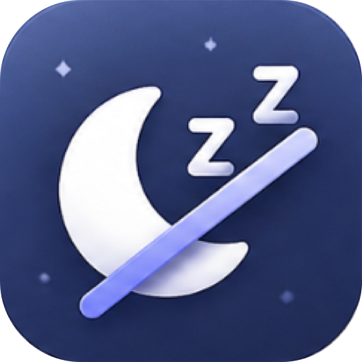
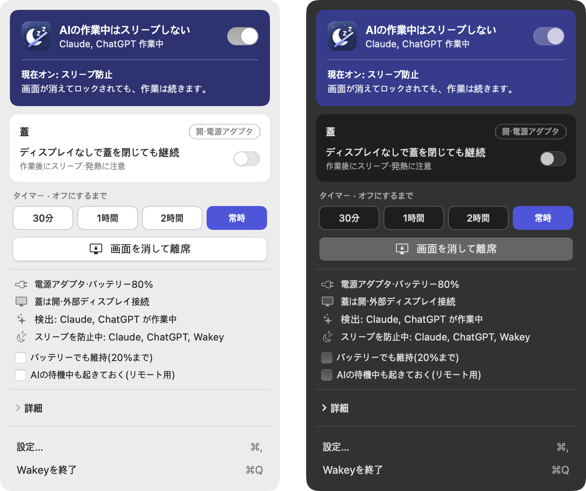

  

<h1 align="center">Wakey</h1>

  <b>AI が作業している間、Mac を起こしておきます。</b> 
  作業が終わればまたスリープさせる、小さなメニューバーアプリ

  <a href="https://github.com/tail-s/wakey/releases/latest"><b>⬇︎ macOS 版をダウンロード</b></a>
  &nbsp;·&nbsp; <a href="README.md">English</a> &nbsp;·&nbsp; <a href="README.ko.md">한국어</a> &nbsp;·&nbsp; 日本語

## こんなアプリです

- **AI が止まりません。** Claude Code、Codex、Antigravity はあなたの Mac 上で動いています。Mac がスリープすると、作業の途中で止まってしまいます。Wakey は AI の作業中、Mac を起こしておきます。
- **スイッチひとつ。** *AIの作業中はスリープしない* をオンにするだけで、あとは Wakey におまかせ。macOS のスリープ設定を覚える必要はありません。
- **画面はいつもどおり消えます。** ディスプレイはいつもどおり消えてロックされます。起きているのは Mac 本体だけです。
- **蓋を閉じても大丈夫。** 蓋モードなら、蓋を閉じても作業が続きます。クラムシェルでは自動でオンになるので、モニターを消しても AI は止まりません。
- **作業が終われば、またスリープ。** AI の作業が終わって数分たつと、Mac がまたスリープできるようにします。
- **Mac にやさしく。** バッテリーが少なくなったり Mac が熱くなったりすると自動で解除し、Wakey が終了・クラッシュしたときも蓋モードをオフにします。
- **日本語で使えます。** 日本語、English、한국어 に対応し、ライト・ダークモードも選べます。
- **プライバシーを守ります。** アプリが作業中かどうかだけを確認します。プロンプト、コード、ファイルは読みません。

## 最新情報

**0.1.0** — 最初のリリースです。[変更履歴](CHANGELOG.md)をご覧ください。

## インストール

1. [最新の **Wakey.dmg** をダウンロード](https://github.com/tail-s/wakey/releases/latest)
2. 開いて **Wakey** を **アプリケーション** フォルダにドラッグします。
3. アプリケーションフォルダから Wakey を開きます。メニューバーにアイコンが表示されます。

macOS 13 Ventura 以降が必要です。Apple シリコンと Intel 搭載の Mac で動作します。

## 使い方

メニューバーの Wakey アイコンをクリックして:

| したいこと | 操作 |
|---|---|
| AI の作業中に Mac を起こしておく | **AIの作業中はスリープしない** をオン。ほとんどの場合、これだけで十分です |
| クラムシェルで使う(蓋を閉じて外部モニター) | 何もしなくて大丈夫。Wakey が蓋モードを自動でオンにします |
| 画面だけ消して AI は動かし続ける | **画面を消して離席** をクリック。クラムシェルでは、モニターの電源ボタンの代わりにこれを使ってください |
| スマートフォンから AI を操作する | **AIの待機中も起きておく** をオン。AI が待機している間も Mac に接続できます |
| バッテリーでも動かし続ける | **バッテリーでも維持** をオン。それでも 20% になると解除します |
| モニターなしで蓋を閉じる | **ディスプレイなしで蓋を閉じても継続** をオン。作業が終わるとすぐスリープします |
| 一定時間だけオンにする | タイマーで **30分**、**1時間**、**2時間** から選びます |
| 手動でオン・オフする | **詳細** を開きます |

**蓋モードは最初に一度だけ許可が必要です。** **設定 › 一般 › 蓋モード** で **インストール…** をクリックし、
**システム設定 › 一般 › ログイン項目と機能拡張** で Wakey を許可してください。ほかの機能はすぐに使えます。

## Mac がスリープするまでの段階

Mac を使わずにいると、次の段階を順番に進みます。**AI が止まるのは段階 4 から**で、Wakey が受け持つのもこの段階です。

| 段階 | 何が起きるか | AI は動き続ける? | Wakey |
|---|---|---|---|
| 1. スクリーンセーバー | 数分操作しないとスクリーンセーバーが始まる | はい | – |
| 2. ディスプレイのオフ | 画面が消える | はい | – |
| 3. ロック | 戻るにはパスワードが必要 | はい | セキュリティのため触りません |
| **4. アイドルスリープ** | 誰も使っていないので Mac 全体がスリープする | **いいえ** | **防ぎます** |
| **5. 蓋を閉じる** | 蓋を閉じる、またはクラムシェルでモニターを消すとすぐスリープする | **いいえ** | **防ぎます**(蓋モード) |
| 6. 手動スリープ | Apple メニューからスリープを選ぶ | いいえ | 蓋モードはこれも防ぎます |
| 7. バッテリー切れ | バッテリーがほぼ空になる | いいえ | 防げません。代わりに早めに解除します |
| 8. ディープスリープ | 長くスリープすると、メモリの内容をディスクに保存する | いいえ | 段階 4〜6 を防げばここまで進みません |

## 対応している AI アプリ

| アプリ | Wakey が作業中だと判断する方法 |
|---|---|
| Claude Code(Claude アプリ、ターミナル) | アプリ自身の信号。Claude Code の信号を追加すると開始・終了まで正確に |
| ChatGPT(Codex) | アプリ自身の信号 |
| Antigravity | 使用状況から推定 |
| ターミナルのエージェント(`claude`、`codex`) | プロセスの動作 |
| クラウドの作業(Claude チャット、ChatGPT、Codex クラウド、Claude Code on the web) | 何もしなくて大丈夫。Mac ではなくサーバーで動いています |

## 好みに合わせて

メニューから **設定**(⌘,)を開きます:

- **一般** — 言語、ライト・ダークモード、ログイン時に起動、タスクの合間も起きておく、AI の作業終了後に解除するまでの時間、解除するバッテリー残量、蓋モード
- **検出** — 検出する AI アプリの選択、開始・終了を正確に知らせる Claude Code の信号の追加
- **情報** — バージョンと新機能

## よくある質問

**画面もオンのままになりますか?**
いいえ。起きているのは Mac だけで、画面はいつもどおり消えてロックされます。画面もオンにしておきたい場合は **詳細 › 画面をオンのまま** をオンにしてください。

**クラムシェルでモニターを消すと、なぜ Mac がスリープするのですか?**
蓋が閉じていると、macOS は「モニターなし」を蓋を閉じたのと同じように扱います。Wakey はクラムシェルで蓋モードをオンにしてこれを防ぎます。モニターの電源ボタンの代わりに **画面を消して離席** を使っても大丈夫です。

**蓋モードは安全ですか?**
Mac が熱くなったとき、バッテリーが設定した残量になったとき、Wakey が終了・クラッシュしたときには、蓋モードは自動でオフになります。MacBook Air はファンがないので、AI の作業中にきついバッグへ入れるのは避けてください。

**Claude Code の信号を追加すると、何が変わりますか?**
`~/.claude/settings.json` に小さな開始・終了のフックを追加し、元のファイルはバックアップします。**設定 › 検出** で **削除** をクリックすれば取り除けます。

**Wakey をアンインストールするには?**
設定で蓋モードのヘルパーと Claude Code の信号を追加していれば、先に削除してください。そのあと Wakey を終了し、アプリケーションフォルダからゴミ箱に移します。

**うまく動かない、またはアイデアがある**
[Issue を作成](https://github.com/tail-s/wakey/issues)してください。どんなご意見も歓迎です。

## 開発者向け

Wakey は Swift と SwiftUI で作られています。自分でビルドする、コントリビュートする、リリースを公開する方法は
[docs/DEVELOPMENT.md](docs/DEVELOPMENT.md)(英語)をご覧ください。
