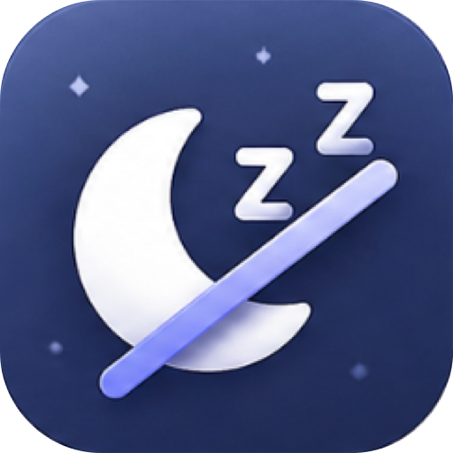
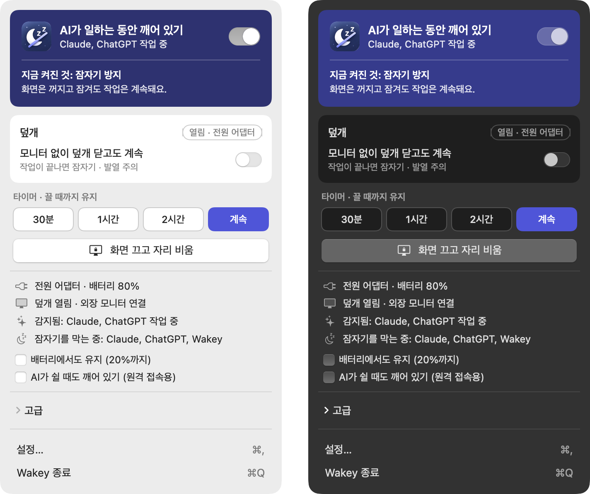

  

<h1 align="center">Wakey</h1>

  <b>AI가 일하는 동안 Mac을 깨워 둬요.</b> 
  일이 끝나면 다시 잠들게 해 주는 작은 메뉴 막대 앱

  <a href="https://github.com/tail-s/wakey/releases/latest"><b>⬇︎ macOS용 다운로드</b></a>
  &nbsp;·&nbsp; <a href="README.md">English</a> &nbsp;·&nbsp; 한국어 &nbsp;·&nbsp; <a href="README.ja.md">日本語</a>

## 이런 앱이에요

- **AI가 멈추지 않아요.** Claude Code, Codex, Antigravity는 내 Mac에서 돌아가요. Mac이 잠들면 하던 작업도 중간에 멈추죠. Wakey는 AI가 일하는 동안 Mac을 깨워 둬요.
- **스위치 하나면 끝.** *AI가 일하는 동안 깨어 있기*만 켜면 나머지는 Wakey가 알아서 해요. macOS 잠자기 설정을 몰라도 돼요.
- **화면은 그대로 꺼져요.** 화면은 평소처럼 꺼지고 잠겨요. Mac 본체만 깨어 있어요.
- **덮개를 닫아도 돼요.** 덮개 모드를 켜면 덮개를 닫아도 계속 일해요. 클램쉘에서는 알아서 켜지니까 모니터를 꺼도 AI가 멈추지 않아요.
- **일이 끝나면 다시 잠들어요.** AI가 작업을 마치고 몇 분 지나면 Mac이 다시 잠들 수 있게 놓아줘요.
- **Mac을 아껴요.** 배터리가 부족하거나 Mac이 뜨거워지면 알아서 놓아주고, Wakey가 종료되거나 멈추면 덮개 모드도 꺼요.
- **우리말로.** 한국어, English, 日本語를 고를 수 있고, 라이트·다크 모드를 지원해요.
- **내 정보는 안 봐요.** 앱이 작업 중인지만 확인해요. 프롬프트, 코드, 파일은 읽지 않아요.

## 새 소식

**0.1.0**: 첫 출시예요. [전체 변경 내역](CHANGELOG.md)을 확인하세요.

## 설치

1. [최신 **Wakey.dmg** 다운로드](https://github.com/tail-s/wakey/releases/latest)
2. 파일을 열고 **Wakey**를 **응용 프로그램** 폴더로 끌어다 놓으세요.
3. 응용 프로그램 폴더에서 Wakey를 여세요. 메뉴 막대에 아이콘이 나타나요.

macOS 13 Ventura 이상이 필요해요. Apple 실리콘과 Intel Mac 모두에서 동작해요.

## 이렇게 쓰세요

메뉴 막대의 Wakey 아이콘을 누른 다음:

| 하고 싶은 일 | 이렇게 하세요 |
|---|---|
| AI가 일하는 동안 Mac 깨워 두기 | **AI가 일하는 동안 깨어 있기**를 켜세요. 대부분 이것만으로 충분해요 |
| 클램쉘로 쓰기 (덮개 닫고 외장 모니터) | 따로 할 일 없어요. Wakey가 덮개 모드를 알아서 켜요 |
| 화면만 끄고 AI는 계속 돌리기 | **화면 끄고 자리 비움**을 누르세요. 클램쉘에서는 모니터 전원 버튼 대신 이걸 쓰세요 |
| 휴대폰으로 AI 원격 조종하기 | **AI가 쉴 때도 깨어 있기**를 켜세요. AI가 쉬는 동안에도 Mac에 접속할 수 있어요 |
| 배터리로도 계속 돌리기 | **배터리에서도 유지**를 켜세요. 그래도 20%가 되면 놓아줘요 |
| 모니터 없이 덮개 닫기 | **모니터 없이 덮개 닫고도 계속**을 켜세요. 작업이 끝나면 바로 잠들어요 |
| 일정 시간만 켜 두기 | 타이머에서 **30분**, **1시간**, **2시간** 중에 고르세요 |
| 직접 켜고 끄기 | **고급**을 여세요 |

**덮개 모드는 처음 한 번 허락이 필요해요.** **설정 › 일반 › 덮개 모드**에서 **설치…**를 누른 뒤,
**시스템 설정 › 일반 › 로그인 항목 및 확장 프로그램**에서 Wakey를 허용하세요. 나머지 기능은 바로 쓸 수 있어요.

## Mac이 잠드는 단계

Mac을 쓰지 않으면 아래 단계를 차례로 거쳐요. **AI가 멈추는 건 4단계부터**이고, Wakey가 맡는 것도 바로 이 단계들이에요.

| 단계 | 무슨 일이 일어나나요 | AI는 계속 일하나요? | Wakey |
|---|---|---|---|
| 1. 화면 보호기 | 몇 분 동안 안 쓰면 화면 보호기가 시작돼요 | 네 | – |
| 2. 디스플레이 끄기 | 화면이 꺼져요 | 네 | – |
| 3. 잠금 | 다시 쓰려면 암호가 필요해요 | 네 | 보안을 위해 건드리지 않아요 |
| **4. 유휴 잠자기** | 아무도 안 쓰니 Mac 전체가 잠들어요 | **아니요** | **막아요** |
| **5. 덮개 닫기** | 덮개를 닫거나, 클램쉘에서 모니터를 끄면 바로 잠들어요 | **아니요** | **막아요** (덮개 모드) |
| 6. 수동 잠자기 | Apple 메뉴에서 잠자기를 눌러요 | 아니요 | 덮개 모드가 이것도 막아요 |
| 7. 배터리 부족 | 배터리가 거의 바닥났어요 | 아니요 | 막을 수 없어요. 대신 미리 놓아줘요 |
| 8. 깊은 잠자기 | 오래 잠들어 있으면 메모리를 디스크에 저장해요 | 아니요 | 4~6단계를 막으면 여기까지 가지 않아요 |

## 함께 쓰는 AI 앱

| 앱 | Wakey가 작업 중인지 아는 방법 |
|---|---|
| Claude Code (Claude 앱, 터미널) | 앱이 보내는 신호. Claude Code 신호를 추가하면 시작·종료까지 정확히 |
| ChatGPT (Codex) | 앱이 보내는 신호 |
| Antigravity | 사용량으로 추정 |
| 터미널 에이전트 (`claude`, `codex`) | 프로세스 활동 |
| 클라우드 작업 (Claude 채팅, ChatGPT, Codex 클라우드, Claude Code 웹) | 할 일이 없어요. Mac이 아니라 서버에서 돌아가요 |

## 내 취향대로

메뉴에서 **설정**(⌘,)을 여세요:

- **일반**: 언어, 라이트·다크 모드, 로그인 시 실행, 작업 사이에도 깨어 있기, AI 작업이 끝난 뒤 놓아줄 때까지의 시간, 멈출 배터리 잔량, 덮개 모드
- **감지**: 지켜볼 AI 앱 고르기, 시작·종료를 정확히 알려 주는 Claude Code 신호 추가
- **정보**: 버전과 새 소식

## 궁금한 점

**화면도 계속 켜져 있나요?**
아니요. Mac만 깨어 있고, 화면은 평소처럼 꺼지고 잠겨요. 화면도 켜 두고 싶다면 **고급 › 화면 켜두기**를 켜세요.

**클램쉘에서 모니터를 끄면 왜 Mac이 잠드나요?**
덮개가 닫혀 있으면 macOS는 '모니터 없음'을 덮개를 닫은 것과 똑같이 봐요. Wakey는 클램쉘에서 덮개 모드를 켜서 이걸 막아요. 모니터 전원 버튼 대신 **화면 끄고 자리 비움**을 눌러도 돼요.

**덮개 모드는 안전한가요?**
Mac이 뜨거워지거나, 배터리가 정해 둔 잔량에 닿거나, Wakey가 종료되거나 멈추면 덮개 모드는 알아서 꺼져요. MacBook Air는 팬이 없으니, AI가 일하는 동안 꽉 끼는 가방에 넣지는 마세요.

**Claude Code 신호를 추가하면 무엇이 바뀌나요?**
`~/.claude/settings.json`에 작은 시작·종료 훅을 추가하고, 원래 파일은 백업해 둬요. **설정 › 감지**에서 **제거**를 누르면 다시 빠져요.

**Wakey를 지우려면요?**
설정에서 덮개 모드 도우미와 Claude Code 신호를 추가했다면 먼저 제거하세요. 그다음 Wakey를 종료하고 응용 프로그램 폴더에서 휴지통으로 옮기면 돼요.

**잘 안 되거나 아이디어가 있어요.**
[이슈를 남겨 주세요](https://github.com/tail-s/wakey/issues). 어떤 의견이든 환영해요.

## 개발자를 위한 안내

Wakey는 Swift와 SwiftUI로 만들었어요. 직접 빌드하거나, 기여하거나, 릴리스를 올리는 방법은
[docs/DEVELOPMENT.md](docs/DEVELOPMENT.md)(영어)에 있어요.
