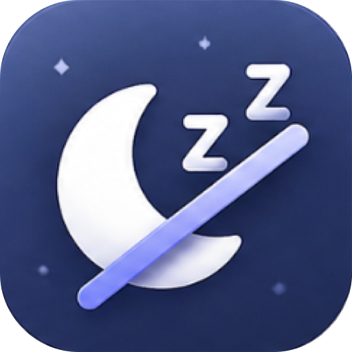
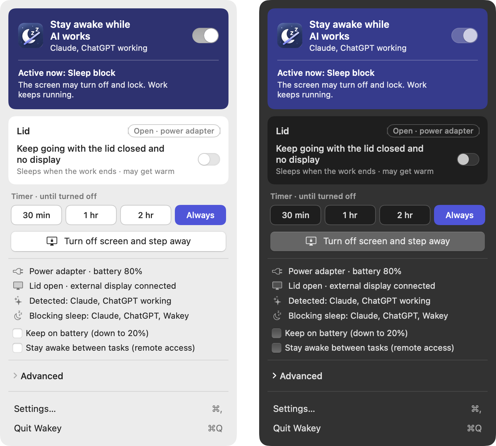

  

<h1 align="center">Wakey</h1>

  <b>Keeps your Mac awake while AI works.</b> 
  A small menu bar app that lets your Mac sleep again when the work is done.

  <a href="https://github.com/tail-s/wakey/releases/latest"><b>⬇︎ Download for macOS</b></a>
  &nbsp;·&nbsp; English &nbsp;·&nbsp; <a href="README.ko.md">한국어</a> &nbsp;·&nbsp; <a href="README.ja.md">日本語</a>

## Why Wakey

- **Your AI keeps working.** Claude Code, Codex and Antigravity run on your Mac. When the Mac falls asleep, they stop in the middle of a task. Wakey keeps it awake while they work.
- **One switch.** Turn on *Stay awake while AI works* and Wakey takes care of the rest. No need to learn macOS sleep settings.
- **The screen still sleeps.** Your display turns off and locks as usual. Only the Mac itself stays awake.
- **Close the lid if you like.** Lid mode keeps going with the lid closed. In clamshell mode it turns on by itself, so turning off the monitor won't stop your AI.
- **Sleeps when the work is done.** A few minutes after your AI finishes, Wakey lets your Mac sleep again.
- **Careful with your Mac.** Wakey lets go when the battery runs low or the Mac gets hot, and turns lid mode off if it ever quits or crashes.
- **Speaks your language.** English, 한국어 and 日本語, in light or dark mode.
- **Private.** Wakey only checks whether apps are working. It never reads your prompts, code or files.

## What's new

**0.1.0** — the first release. See the [full changelog](CHANGELOG.md).

## Install

1. [Download the latest **Wakey.dmg**](https://github.com/tail-s/wakey/releases/latest).
2. Open it and drag **Wakey** into the **Applications** folder.
3. Open Wakey from Applications. Its icon appears in the menu bar.

Needs macOS 13 Ventura or later. Works on Apple silicon and Intel Macs.

## Getting started

Click the Wakey icon in the menu bar, then:

| To… | Do this |
|---|---|
| Keep the Mac awake while AI works | Turn on **Stay awake while AI works**. That's usually all you need |
| Use clamshell mode (lid closed, external monitor) | Nothing extra. Wakey turns lid mode on by itself |
| Turn off the screen but keep the AI running | Click **Turn off screen and step away**. In clamshell mode, use this instead of the monitor's power button |
| Control your AI from your phone | Turn on **Stay awake between tasks**, so the Mac stays reachable while the AI is idle |
| Keep going on battery | Turn on **Keep on battery**. Wakey still lets go at 20% |
| Close the lid with no monitor | Turn on **Keep going with the lid closed and no display**. The Mac sleeps as soon as the work ends |
| Stop after a while | Pick **30 min**, **1 hr** or **2 hr** under Timer |
| Switch things on by hand | Open **Advanced** |

**Lid mode needs your OK once.** Open **Settings › General › Lid mode**, click **Install…**, then allow Wakey in
**System Settings › General › Login Items & Extensions**. Everything else works right away.

## How your Mac falls asleep

When you stop using your Mac, it goes through these stages. **Your AI only stops from stage 4 on**, and those are the stages Wakey handles.

| Stage | What happens | Does your AI keep working? | Wakey |
|---|---|---|---|
| 1. Screen saver | A screen saver starts after a few idle minutes | Yes | – |
| 2. Display off | The screen goes dark | Yes | – |
| 3. Lock | You need your password to get back in | Yes | Left alone, for your security |
| **4. Idle sleep** | The whole Mac sleeps because no one is using it | **No** | **Blocks it** |
| **5. Lid closed** | Closing the lid, or turning off the monitor in clamshell mode, sleeps the Mac at once | **No** | **Blocks it** (lid mode) |
| 6. Manual sleep | You choose Sleep from the Apple menu | No | Lid mode blocks this too |
| 7. Low battery | The battery is almost empty | No | Can't be blocked. Wakey lets go early instead |
| 8. Deep sleep | After a long sleep, memory is saved to disk | No | Never reached while 4–6 are blocked |

## Works with

| App | How Wakey knows it's working |
|---|---|
| Claude Code (Claude app and terminal) | The app's own signal, or exact start and finish signals with Claude Code hooks |
| ChatGPT (Codex) | The app's own signal |
| Antigravity | Estimated from activity |
| Terminal agents (`claude`, `codex`) | Process activity |
| Cloud tasks (Claude chat, ChatGPT, Codex cloud, Claude Code on the web) | Nothing to do. They run on servers, not on your Mac |

## Make it yours

Open **Settings** from the menu (⌘,):

- **General** — language, light or dark mode, open at login, stay awake between tasks, when to let go after the AI finishes, the battery level to stop at, and lid mode.
- **Detection** — choose which AI apps to watch, and add Claude Code signals for exact start and finish detection.
- **About** — version and what's new.

## Questions

**Will my screen stay on?**
No. Only the Mac stays awake; the screen turns off and locks as usual. To keep the screen on too, open **Advanced › Keep screen on**.

**Why does my Mac sleep when I turn off the monitor in clamshell mode?**
With the lid closed, macOS treats "no monitor" the same as closing the lid. Wakey turns lid mode on in clamshell mode to prevent this. You can also click **Turn off screen and step away** instead of using the monitor's power button.

**Is lid mode safe?**
Wakey turns it off by itself when the Mac gets hot, when the battery reaches your floor, and if Wakey quits or crashes. A MacBook Air has no fan, so avoid closing it in a tight bag while the AI works.

**What do Claude Code signals change?**
They add small start and finish hooks to `~/.claude/settings.json`, and keep a backup of the original. Click **Remove** in Settings › Detection to take them out again.

**How do I uninstall Wakey?**
In Settings, remove the lid mode helper and Claude Code signals if you added them. Then quit Wakey and move it from Applications to the Trash.

**Something isn't working, or I have an idea.**
Please [open an issue](https://github.com/tail-s/wakey/issues). Feedback is very welcome.

## For developers

Wakey is written in Swift and SwiftUI. To build it yourself, contribute, or publish a release, see
[docs/DEVELOPMENT.md](docs/DEVELOPMENT.md).
